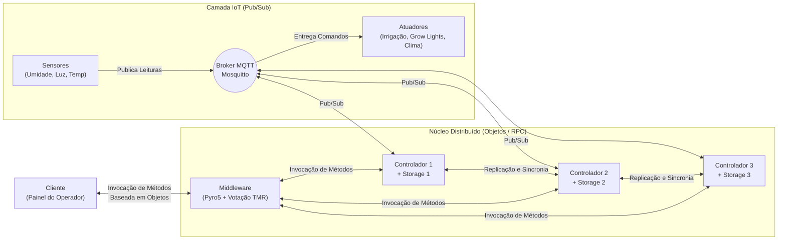

# Guia de Estudos — Sistemas Distribuídos no Projeto Smart Pitch

Este guia foi criado para ajudar você a **dominar todos os conceitos teóricos e práticos** usados no trabalho, facilitando tanto a escrita do relatório quanto a explicação do código para o professor.

---

## 1. Visão Geral da Arquitetura

O nosso sistema combina **dois paradigmas de comunicação** clássicos de Sistemas Distribuídos, exatamente como pedido na Figura 1 do enunciado:

### Por que existem dois tipos de comunicação no trabalho?
1. **Comunicação Indireta (Publish/Subscribe via MQTT):**
   - Usada entre **Sensores, Broker MQTT, Controladores e Atuadores**.
   - **Vantagem (Desacoplamento):** O sensor de umidade não sabe quantos controladores existem nem qual é o IP deles. Ele apenas publica no tópico `estadio/gramado/sensores`. Isso permite adicionar novos controladores (réplicas) sem alterar uma linha de código nos sensores.
2. **Comunicação Direta Baseada em Objetos (RMI/RPC via Pyro5):**
   - Usada entre **Cliente $\leftrightarrow$ Middleware $\leftrightarrow$ Controladores**.
   - **Vantagem:** O Cliente chama métodos como se o objeto estivesse na própria máquina (`middleware.obter_estado()`, `middleware.definir_modo("DIA_DE_JOGO")`). O Pyro5 (*Python Remote Objects*) serializa a chamada, envia pela rede e devolve o retorno do método.

---

## 2. Como cada questão do trabalho é resolvida?

Abaixo estão as 4 questões obrigatórias do PDF e a resposta exata que usamos no projeto:

### Questão A: "O tema de seu trabalho? Não pode ser algo muito simples."
- **Nossa resposta:** **Smart Pitch (Gestão Automatizada de Gramado de Arena Multiuso)**.
- **Por que é um bom tema?** Estádios modernos (como Allianz Parque, Santiago Bernabéu, Maracanã) possuem coberturas parciais e calendários intensos (jogos + shows). O gramado precisa de controle cruzado de **3 variáveis vitais**:
  1. **Umidade do Solo (%) $\rightarrow$ Irrigação:** Grama seca aumenta risco de lesão e queima; grama encharcada solta tufos e prejudica a rolagem da bola.
  2. **Radiação Fotossintética / Luminosidade (lux) $\rightarrow$ Grow Lights:** A arquitetura fechada das arenas bloqueia o sol; carrinhos de luz artificial suplementam a fotossíntese quando a luz natural cai.
  3. **Temperatura da Raiz (°C) $\rightarrow$ Climatização Subterrânea:** Mantém a zona radicular na faixa ideal (18°C a 26°C) com aquecimento ou ventilação forçada.
  4. **Contexto de Negócio (Modo Dia de Jogo):** Durante uma partida (`DIA_DE_JOGO`), mesmo que a umidade caia, os sprinklers **não podem ligar no meio do jogo**. O controlador aplica regras contextuais, o que enriquece a tomada de decisão sem complicar o código.

---

### Questão B: "O controlador escolhido possui sempre uma ou várias réplicas para os dados armazenados"
- **Conceito de SD:** **Replicação de Dados e Consistência de Estado**.
- **Como funciona no código:**
  - Temos 3 instâncias de controladores (`Controlador 1`, `Controlador 2`, `Controlador 3`).
  - Cada controlador possui seu próprio banco local em arquivo JSON (`storage_controlador_1.json`, `storage_controlador_2.json`, `storage_controlador_3.json`).
  - Todos os controladores assinam os mesmos tópicos MQTT (recebendo as leituras dos sensores simultaneamente) e, quando ocorre qualquer mudança de estado ou comando manual, eles sincronizam o armazenamento entre si via chamada remota (`sincronizar_estado`), mantendo os 3 arquivos JSON idênticos.
  - Se um controlador cair e voltar depois, ele pode recuperar o estado atualizado com as réplicas ativas.

---

### Questão C: "Garantir que o cliente obtenha um resultado positivo quanto à execução de um método, mesmo que o controlador caia"
- **Conceito de SD:** **Tolerância a Falhas por Parada (Crash-Fault Tolerance) e Transparência de Falha**.
- **Como funciona no código:**
  - O **Cliente nunca fala diretamente com um Controlador específico**; ele fala apenas com o **Middleware**.
  - Quando o cliente chama um método no Middleware, o Middleware tenta invocar o método nas réplicas (`Controlador 1`, `2` e `3`) com tratamento de exceções de rede (`Pyro5.errors.CommunicationError`).
  - Se o `Controlador 1` for fechado (`Ctrl+C`), o Middleware detecta que ele está offline, ignora a falha de conexão e obtém o resultado positivo através dos `Controladores 2 e 3`.
  - **Para o cliente, a queda é 100% transparente:** a chamada retorna sucesso normalmente.

---

### Questão D: "Resolver problemas de segurança: se os controladores começarem a responder valores que não conferem, seja por terem sido invadidos ou por erros intermitentes?"
- **Conceito de SD:** **Tolerância a Falhas Bizantinas (Byzantine Fault Tolerance - BFT) via Redundância Modular Tripla (TMR - Triple Modular Redundancy) e Votação por Maioria**.
- **O que é uma Falha Bizantina?**
  - Na falha comum (*crash*), o servidor para de responder. Na **falha bizantina** (invasão hacker, bug de memória ou falha intermitente), o servidor **continua respondendo, mas mente** (ex.: diz que a umidade está em `999%` ou diz que a irrigação está desligada quando está ligada).
- **Por que precisamos de 3 controladores ($2f + 1$)?**
  - Se tivéssemos apenas 2 controladores e 1 fosse invadido, o Controlador 1 diria `Umidade = 45%` e o Controlador 2 diria `Umidade = 90%`. O Middleware saberia que há um erro, mas **não saberia quem está falando a verdade**.
  - Com **3 controladores**, se 1 for invadido ($f = 1$), os outros **2 controladores honestos** devolvem exatamente o mesmo estado.
  - O Middleware aplica:
    1. **Sanity Check (Validação de Limites Físicos):** Descarta imediatamente leituras impossíveis (ex.: umidade $< 0\%$ ou $> 100\%$, temperatura fora de $-20^\circ\text{C}$ a $80^\circ\text{C}$).
    2. **Votação por Maioria (Quórum 2 de 3):** Compara os estados retornados pelos 3 controladores. O valor que tiver a maioria dos votos é entregue ao Cliente, e o Middleware registra um alerta indicando qual controlador divergiu (possível invasão ou falha intermitente).

---

## 3. Dicionário Rápido para Apresentação

| Termo | Explicação Simples para a Apresentação |
| :--- | :--- |
| **Middleware** | Camada de software que fica entre o Cliente e os Controladores, escondendo a complexidade da rede, das réplicas e das falhas. |
| **Transparência de Replicação** | O Cliente acha que está falando com um único sistema, sem saber que existem 3 controladores trabalhando atrás do Middleware. |
| **Transparência de Falha** | Mesmo que um controlador caia ou seja invadido, o Cliente continua operando sem perceber erro. |
| **Pub/Sub (MQTT)** | Modelo onde quem envia (Publisher/Sensor) não conhece quem recebe (Subscriber/Controlador); o Broker Mosquitto faz o correio. |
| **Invocação Remota de Métodos (Pyro5)** | Permite chamar funções de um objeto Python que está rodando em outro processo/computador como se fosse um objeto local. |
| **TMR (Redundância Modular Tripla)** | Técnica clássica de tolerância a falhas onde 3 módulos executam a mesma tarefa e um votador (no nosso caso, o Middleware) escolhe a resposta da maioria (2 contra 1). |

---

## 4. Detalhamento dos Módulos Implementados

### Etapa 2: `gramado/config.py`, `gramado/sensores.py` e `gramado/atuadores.py`
- **Organização Modular (`gramado/`):** Todo o subsistema do Smart Pitch fica isolado dentro da pasta `gramado/`, mantendo na raiz apenas a infraestrutura compartilhada do estádio (`docker-compose.yml`, `mosquitto/`, `requirements.txt` e `docs/`). Isso permite escalar futuramente para outros setores do estádio (ex.: `iluminacao/`, `catracas/`, `placar/`) sem refatorar a base.
- **[`gramado/config.py`](../gramado/config.py):** Centraliza constantes para evitar valores fixos espalhados pelo código:
  - Tópicos MQTT: `estadio/gramado/sensores` e `estadio/gramado/atuadores`.
  - Limiares agronômicos:
    - Umidade $< 40\%$ liga irrigação; $> 65\%$ desliga.
    - Luminosidade $< 12.000\text{ lux}$ liga as *Grow Lights*.
    - Temperatura $< 16^\circ\text{C}$ liga aquecimento; $> 27^\circ\text{C}$ liga resfriamento/ventilação.
  - Endereços Pyro5 diretos (`PYRO:gramado.controlador.X@localhost:909X`), o que dispensa a execução de um servidor de nomes externo (`pyro5-ns`) e torna o projeto muito mais simples de subir.
- **[`gramado/sensores.py`](../gramado/sensores.py):** Usa funções senoidais com leve ruído aleatório para gerar leituras a cada 3 segundos. Isso garante que, durante a apresentação, o professor veja os valores cruzando as faixas críticas automaticamente (acionando e desligando irrigação, luzes e climatização sem precisar esperar horas).
- **[`gramado/atuadores.py`](../gramado/atuadores.py):** Assina `estadio/gramado/atuadores` e mantém o estado físico atual dos equipamentos do estádio, destacando no terminal sempre que uma transição física ocorre (`[MUDANCA FISICA]`).

### Etapa 3: [`gramado/controlador.py`](../gramado/controlador.py) (Controlador de Processo e Replicação)
- **Execução Múltipla (Réplicas):** O mesmo código roda as 3 réplicas passando o ID por argumento (`python gramado/controlador.py 1`, `2` ou `3`), escutando nas portas `9091`, `9092` e `9093`.
- **Ponte entre MQTT e Objetos Remotos (Pyro5):**
  - Como **assinante MQTT**, recebe cada leitura dos sensores e aplica o método `_aplicar_regras_decisao()`.
  - Como **publicador MQTT**, envia comandos para `estadio/gramado/atuadores` sempre que o estado de irrigação, iluminação artificial ou climatização muda.
  - Como **objeto Pyro5 (`@Pyro5.api.expose`)**, disponibiliza métodos para o Middleware (`obter_estado`, `definir_modo`, `acionar_atuador_manual`) e para sincronia entre réplicas (`receber_replicacao`, `obter_estado_interno`).
- **Replicação de Armazenamento:**
  - Cada controlador grava seu estado e histórico recente em `gramado/storage/storage_controlador_X.json` com um contador incremental de `versao`.
  - Quando recebe um comando ou muda seu estado, propaga a atualização para as réplicas via `_propagar_replicacao()`, e quando um controlador é reiniciado após uma queda, chama `sincronizar_ao_iniciar()` para copiar a versão mais recente de outra réplica ativa.
- **Simulação de Invasão / Falha Bizantina (`definir_comprometimento`):**
  - Quando ativada a flag `comprometido = True` em um controlador, ele passa a devolver valores absurdos/adulterados (`umidade_solo = 999.9`, `temperatura_grama = -45.0`, modos inválidos), permitindo demonstrar de forma prática a defesa do Middleware.

### Etapa 4: [`gramado/middleware.py`](../gramado/middleware.py) (Middleware de Objetos, Tolerância a Falhas e TMR)
- **Papel na Arquitetura:** O Middleware fica na porta `9090` (`PYRO:gramado.middleware@localhost:9090`) e é o **único ponto de contato do Cliente**.
- **Como ele garante que o cliente receba resposta positiva mesmo que um controlador caia?**
  - Nos métodos `obter_visao_geral()`, `definir_modo_operacao()` e `acionar_atuador()`, o Middleware percorre as 3 réplicas (`Controlador 1`, `2` e `3`) dentro de blocos `try/except` com timeout curto (`1.5s`).
  - Se o `Controlador 1` cair (ou for encerrado no terminal), a exceção de rede é capturada, o nó é marcado como `OFFLINE (Inacessivel)` e a operação conclui com sucesso usando os `Controladores 2 e 3`.
- **Como ele resolve o problema de segurança (controlador invadido ou com erro intermitente)?**
  - Aplica uma defesa em **duas camadas**:
    1. **1ª Barreira — Sanity Check (`_validar_estado_plausivel`):** Verifica se os modos de operação, estados de atuadores e grandezas físicas dos sensores estão dentro dos limites reais definidos em `LIMITES_FISICOS`. Leituras absurdas (como umidade `999.9%` ou modo `MODO_HACKED`) são bloqueadas imediatamente.
    2. **2ª Barreira — Votação por Maioria / TMR (`_assinatura_consenso` + `Counter`):** Mesmo que um controlador invadido tente mentir dentro dos limites físicos (por exemplo, dizendo que a irrigação está `LIGADO` quando na verdade está `DESLIGADO`), o Middleware compara as assinaturas de resposta dos 3 controladores e escolhe a resposta majoritária (2 votos contra 1), isolando o controlador divergente e emitindo alerta de segurança para o cliente.

### Etapa 5: [`gramado/cliente.py`](../gramado/cliente.py) e [`gramado/start_all.py`](../gramado/start_all.py) (Painel do Operador e Inicializador)
- **[`gramado/cliente.py`](../gramado/cliente.py):**
  - Conecta-se **exclusivamente ao Middleware** (`PYRO:gramado.middleware@localhost:9090`), demonstrando a transparência de localização e de replicação.
  - Exibe em tempo real:
    - O estado de saúde de cada réplica (`ONLINE (Integro)`, `OFFLINE (Inacessivel)` ou `INVADIDO/ERRO`).
    - O quórum de consenso TMR (ex.: `3/3 controladores concordam` ou `2/3 controladores concordam`).
    - Os alertas de segurança gerados quando um controlador diverge ou mente.
    - Os valores dos sensores, estados dos atuadores e últimos eventos gravados no storage replicado.
  - Oferece a opção `[5] [Teste SD] Simular Invasao/Falha Bizantina em um Controlador` para facilitar a demonstração ao vivo para o professor sem precisar editar código.
- **[`gramado/start_all.py`](../gramado/start_all.py):**
  - Abre automaticamente as 7 janelas do sistema distribuído (Controladores 1, 2 e 3, Middleware, Atuadores, Sensores e Cliente) com um único comando.

---

## 5. Roteiro Prático de Apresentação (3 Minutos)

Se você precisar apresentar ou gravar um vídeo mostrando o trabalho funcionando, siga esta sequência rápida que comprova todos os itens da avaliação:

1. **Subir o sistema:**
   - Com o container do Mosquitto ativo (`docker compose up -d`), rode `python gramado/start_all.py`.
   - Mostre rapidamente as janelas abertas: Sensores publicando no MQTT, Atuadores recebendo comandos e os 3 Controladores sincronizados.
2. **Mostrar a Replicação de Armazenamento:**
   - Abra a pasta `gramado/storage/` e mostre que `storage_controlador_1.json`, `2` e `3` estão sendo atualizados juntos na mesma `versao`.
3. **Demonstrar comando do Cliente via Middleware:**
   - Na janela do Cliente, escolha `[3] Alterar Modo de Operacao` $\rightarrow$ `[2] DIA_DE_JOGO`.
   - Destaque que a irrigação e as *Grow Lights* são travadas em `DESLIGADO` imediatamente para proteger a partida.
4. **Provar Tolerância a Falha por Queda (Crash):**
   - Feche a janela do `Controlador 1` (ou dê `Ctrl+C` nela).
   - No Cliente, envie qualquer comando (ex.: voltar para `[1] AUTOMATICO`).
   - Mostre que o comando **funciona sem erro**, o painel mostra `[!!] Controlador 1: OFFLINE (Inacessivel)` e o quórum continua positivo (`2/3 controladores concordam`).
5. **Provar Segurança contra Invasão / Falha Bizantina (TMR):**
   - Religar o `Controlador 1` (`python gramado/controlador.py 1`) — destaque que ele sincroniza sozinho ao iniciar!
   - No Cliente, escolha `[5] Simular Invasao/Falha Bizantina` $\rightarrow$ escolha o `Controlador 2` $\rightarrow$ `[1] SIMULAR INVASAO`.
   - Mostre no painel do Cliente que o Middleware detecta na hora: `[!!] Controlador 2: INVADIDO/ERRO`, exibe o alerta de segurança na tela, mas **entrega ao cliente os dados corretos** graças ao voto majoritário dos Controladores 1 e 3!

