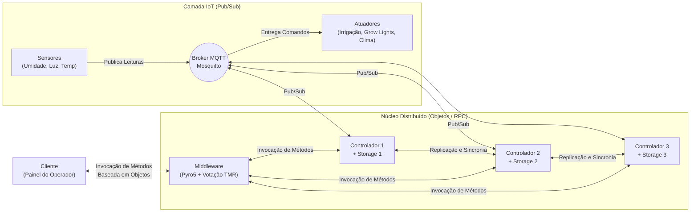

# Guia de Estudos — Sistemas Distribuídos no Projeto Smart Pitch

Este guia foi criado para ajudar você a **dominar todos os conceitos teóricos e práticos** usados no trabalho, facilitando tanto a escrita do relatório quanto a explicação do código para o professor.

---

## 1. Visão Geral da Arquitetura

O nosso sistema combina **dois paradigmas de comunicação** clássicos de Sistemas Distribuídos, exatamente como pedido na Figura 1 do enunciado:

### Por que existem dois tipos de comunicação no trabalho?
1. **Comunicação Indireta (Publish/Subscribe via MQTT):**
   - Usada entre **Sensores, Broker MQTT, Controladores e Atuadores**.
   - **Vantagem (Desacoplamento):** O sensor de umidade não sabe quantos controladores existem nem qual é o IP deles. Ele apenas publica no tópico `estadio/gramado/sensores`. Isso permite adicionar novos controladores (réplicas) sem alterar uma linha de código nos sensores.
2. **Comunicação Direta Baseada em Objetos (RMI/RPC via Pyro5):**
   - Usada entre **Cliente $\leftrightarrow$ Middleware $\leftrightarrow$ Controladores**.
   - **Vantagem:** O Cliente chama métodos como se o objeto estivesse na própria máquina (`middleware.obter_estado()`, `middleware.definir_modo("DIA_DE_JOGO")`). O Pyro5 (*Python Remote Objects*) serializa a chamada, envia pela rede e devolve o retorno do método.

---

## 2. Como cada questão do trabalho é resolvida?

Abaixo estão as 4 questões obrigatórias do PDF e a resposta exata que usamos no projeto:

### Questão A: "O tema de seu trabalho? Não pode ser algo muito simples."
- **Nossa resposta:** **Smart Pitch (Gestão Automatizada de Gramado de Arena Multiuso)**.
- **Por que é um bom tema?** Estádios modernos (como Allianz Parque, Santiago Bernabéu, Maracanã) possuem coberturas parciais e calendários intensos (jogos + shows). O gramado precisa de controle cruzado de **3 variáveis vitais**:
  1. **Umidade do Solo (%) $\rightarrow$ Irrigação:** Grama seca aumenta risco de lesão e queima; grama encharcada solta tufos e prejudica a rolagem da bola.
  2. **Radiação Fotossintética / Luminosidade (lux) $\rightarrow$ Grow Lights:** A arquitetura fechada das arenas bloqueia o sol; carrinhos de luz artificial suplementam a fotossíntese quando a luz natural cai.
  3. **Temperatura da Raiz (°C) $\rightarrow$ Climatização Subterrânea:** Mantém a zona radicular na faixa ideal (18°C a 26°C) com aquecimento ou ventilação forçada.
  4. **Contexto de Negócio (Modo Dia de Jogo):** Durante uma partida (`DIA_DE_JOGO`), mesmo que a umidade caia, os sprinklers **não podem ligar no meio do jogo**. O controlador aplica regras contextuais, o que enriquece a tomada de decisão sem complicar o código.

---

### Questão B: "O controlador escolhido possui sempre uma ou várias réplicas para os dados armazenados"
- **Conceito de SD:** **Replicação de Dados e Consistência de Estado**.
- **Como funciona no código:**
  - Temos 3 instâncias de controladores (`Controlador 1`, `Controlador 2`, `Controlador 3`).
  - Cada controlador possui seu próprio banco local em arquivo JSON (`storage_controlador_1.json`, `storage_controlador_2.json`, `storage_controlador_3.json`).
  - Todos os controladores assinam os mesmos tópicos MQTT (recebendo as leituras dos sensores simultaneamente) e, quando ocorre qualquer mudança de estado ou comando manual, eles sincronizam o armazenamento entre si via chamada remota (`sincronizar_estado`), mantendo os 3 arquivos JSON idênticos.
  - Se um controlador cair e voltar depois, ele pode recuperar o estado atualizado com as réplicas ativas.

---

### Questão C: "Garantir que o cliente obtenha um resultado positivo quanto à execução de um método, mesmo que o controlador caia"
- **Conceito de SD:** **Tolerância a Falhas por Parada (Crash-Fault Tolerance) e Transparência de Falha**.
- **Como funciona no código:**
  - O **Cliente nunca fala diretamente com um Controlador específico**; ele fala apenas com o **Middleware**.
  - Quando o cliente chama um método no Middleware, o Middleware tenta invocar o método nas réplicas (`Controlador 1`, `2` e `3`) com tratamento de exceções de rede (`Pyro5.errors.CommunicationError`).
  - Se o `Controlador 1` for fechado (`Ctrl+C`), o Middleware detecta que ele está offline, ignora a falha de conexão e obtém o resultado positivo através dos `Controladores 2 e 3`.
  - **Para o cliente, a queda é 100% transparente:** a chamada retorna sucesso normalmente.

---

### Questão D: "Resolver problemas de segurança: se os controladores começarem a responder valores que não conferem, seja por terem sido invadidos ou por erros intermitentes?"
- **Conceito de SD:** **Tolerância a Falhas Bizantinas (Byzantine Fault Tolerance - BFT) via Redundância Modular Tripla (TMR - Triple Modular Redundancy) e Votação por Maioria**.
- **O que é uma Falha Bizantina?**
  - Na falha comum (*crash*), o servidor para de responder. Na **falha bizantina** (invasão hacker, bug de memória ou falha intermitente), o servidor **continua respondendo, mas mente** (ex.: diz que a umidade está em `999%` ou diz que a irrigação está desligada quando está ligada).
- **Por que precisamos de 3 controladores ($2f + 1$)?**
  - Se tivéssemos apenas 2 controladores e 1 fosse invadido, o Controlador 1 diria `Umidade = 45%` e o Controlador 2 diria `Umidade = 90%`. O Middleware saberia que há um erro, mas **não saberia quem está falando a verdade**.
  - Com **3 controladores**, se 1 for invadido ($f = 1$), os outros **2 controladores honestos** devolvem exatamente o mesmo estado.
  - O Middleware aplica:
    1. **Sanity Check (Validação de Limites Físicos):** Descarta imediatamente leituras impossíveis (ex.: umidade $< 0\%$ ou $> 100\%$, temperatura fora de $-20^\circ\text{C}$ a $80^\circ\text{C}$).
    2. **Votação por Maioria (Quórum 2 de 3):** Compara os estados retornados pelos 3 controladores. O valor que tiver a maioria dos votos é entregue ao Cliente, e o Middleware registra um alerta indicando qual controlador divergiu (possível invasão ou falha intermitente).

---

## 3. Dicionário Rápido para Apresentação

| Termo | Explicação Simples para a Apresentação |
| :--- | :--- |
| **Middleware** | Camada de software que fica entre o Cliente e os Controladores, escondendo a complexidade da rede, das réplicas e das falhas. |
| **Transparência de Replicação** | O Cliente acha que está falando com um único sistema, sem saber que existem 3 controladores trabalhando atrás do Middleware. |
| **Transparência de Falha** | Mesmo que um controlador caia ou seja invadido, o Cliente continua operando sem perceber erro. |
| **Pub/Sub (MQTT)** | Modelo onde quem envia (Publisher/Sensor) não conhece quem recebe (Subscriber/Controlador); o Broker Mosquitto faz o correio. |
| **Invocação Remota de Métodos (Pyro5)** | Permite chamar funções de um objeto Python que está rodando em outro processo/computador como se fosse um objeto local. |
| **TMR (Redundância Modular Tripla)** | Técnica clássica de tolerância a falhas onde 3 módulos executam a mesma tarefa e um votador (no nosso caso, o Middleware) escolhe a resposta da maioria (2 contra 1). |

---

## 4. Detalhamento dos Módulos Implementados

### Etapa 2: `config.py`, `sensores.py` e `atuadores.py`
- **[`config.py`](../config.py):** Centraliza constantes para evitar valores fixos espalhados pelo código:
  - Tópicos MQTT: `estadio/gramado/sensores` e `estadio/gramado/atuadores`.
  - Limiares agronômicos:
    - Umidade $< 40\%$ liga irrigação; $> 65\%$ desliga.
    - Luminosidade $< 12.000\text{ lux}$ liga as *Grow Lights*.
    - Temperatura $< 16^\circ\text{C}$ liga aquecimento; $> 27^\circ\text{C}$ liga resfriamento/ventilação.
  - Endereços Pyro5 diretos (`PYRO:controlador.X@localhost:909X`), o que dispensa a execução de um servidor de nomes externo (`pyro5-ns`) e torna o projeto muito mais simples de subir.
- **[`sensores.py`](../sensores.py):** Usa funções senoidais com leve ruído aleatório para gerar leituras a cada 3 segundos. Isso garante que, durante a apresentação, o professor veja os valores cruzando as faixas críticas automaticamente (acionando e desligando irrigação, luzes e climatização sem precisar esperar horas).
- **[`atuadores.py`](../atuadores.py):** Assina `estadio/gramado/atuadores` e mantém o estado físico atual dos equipamentos do estádio, destacando no terminal sempre que uma transição física ocorre (`[MUDANCA FISICA]`).

