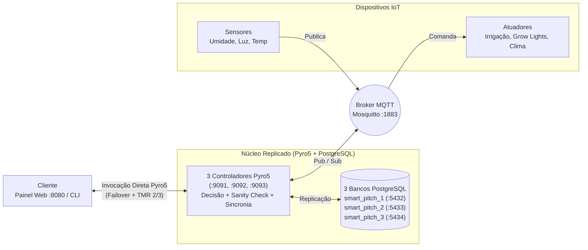

# Guia de Estudos — Sistemas Distribuídos no Projeto Smart Pitch

Este guia resume os conceitos teóricos e práticos do trabalho para facilitar a apresentação e a explicação do código.

---

## 1. Visão Geral da Arquitetura

O sistema combina **dois paradigmas clássicos de Sistemas Distribuídos**, seguindo a Figura 1 do enunciado (sem servidor intermediário entre Cliente e Controladores):

### Por que existem dois tipos de comunicação?
1. **Comunicação Indireta (Publish/Subscribe via MQTT):**
   - Usada entre **Sensores, Broker MQTT, Controladores e Atuadores**.
   - **Vantagem (Desacoplamento):** Os sensores publicam no tópico `estadio/gramado/sensores` sem precisar saber quantos controladores existem.
2. **Comunicação Direta Baseada em Objetos (RMI/RPC via Pyro5):**
   - Usada diretamente entre **Cliente $\leftrightarrow$ Controladores** (`gramado/cliente_rpc.py` $\rightarrow$ `gramado/controlador.py`) e entre **Controladores** para replicação.
   - **Vantagem:** O Cliente invoca métodos diretamente nos objetos remotos dos controladores (`obter_estado`, `definir_modo`, `acionar_atuador_manual`) sem nenhuma camada/servidor extra repassando a conexão.

---

## 2. Como cada questão do trabalho é resolvida?

### Questão A: Tema não trivial
- **Smart Pitch (Gestão Automatizada de Gramado):** controla **Umidade (%) → Irrigação** (com histerese 40%–65%), **Luminosidade (lux) → Grow Lights** (< 12.000 lux) e **Temperatura (°C) → Climatização Subterrânea** (< 16°C ou > 27°C), além dos modos `AUTOMATICO`, `DIA_DE_JOGO` e `MANUAL`.

### Questão B: Réplicas para os dados armazenados
- Cada controlador (`1, 2, 3`) possui seu próprio **banco PostgreSQL independente** (`smart_pitch_1`, `smart_pitch_2`, `smart_pitch_3` nas portas `5432`, `5433`, `5434`), acessado via [`gramado/storage_db.py`](../gramado/storage_db.py).
- O estado possui versão crescente (`versao`) e é replicado via Pyro5 (`_propagar_replicacao` / `receber_replicacao`) e recuperado na subida (`sincronizar_ao_iniciar`).

### Questão C: Garantir resultado positivo mesmo se um controlador cair
- A camada local [`gramado/cliente_rpc.py`](../gramado/cliente_rpc.py) (`ClienteControladoresRPC`) invoca diretamente as réplicas ativas com timeout curto (`1.5s`) e captura falhas de rede.
- Se um ou dois controladores caírem (*crash*), o cliente continua operando com sucesso através dos controladores sobreviventes.

### Questão D: Segurança (controladores invadidos ou com erros intermitentes)
- **1ª Barreira — *Sanity Check* (`validar_estado_plausivel` e `validar_leituras_sensores` em [`gramado/config.py`](../gramado/config.py)):** valida faixas físicas e estados permitidos tanto no Controlador (antes de salvar no PostgreSQL ou aceitar replicação) quanto no Cliente.
- **2ª Barreira — Votação por Maioria / TMR 2 de 3 (`ClienteControladoresRPC`):** compara as assinaturas de resposta dos 3 controladores e adota a decisão majoritária, isolando o voto divergente com alerta de segurança.

---

## 3. Roteiro Prático de Apresentação (3 Minutos)

1. **Subir infraestrutura e sistema em 1 único terminal:**
   - `docker compose up -d` (sobe o Mosquitto + os 3 PostgreSQL).
   - `python gramado/start_all.py` (sobe os 3 controladores, sensores, atuadores e abre o **Painel Web Estilo Terminal** em `http://127.0.0.1:8080`).
2. **Mostrar operação normal e replicação PostgreSQL:**
   - No painel web, mostrar os 3 controladores `ONLINE`, quórum `3/3`, e cada controlador ligado ao seu PostgreSQL (`:5432`, `:5433`, `:5434`).
   - Alterar o modo para `DIA_DE_JOGO` pelo botão do painel e mostrar irrigação e *Grow Lights* travados em `DESLIGADO`.
3. **Provar Tolerância a Falha por Queda (*Crash*):**
   - No único terminal aberto (`start_all.py`), digitar `1` para derrubar o **Controlador 1**.
   - No painel web, trocar o modo para `AUTOMATICO`: o comando **funciona normalmente**, mostrando `Controlador 1: OFFLINE` e quórum `2/3`.
   - Digitar `1` novamente no terminal para religar o Controlador 1 e mostrar que ele sincroniza a versão com os pares e volta `ONLINE`.
4. **Provar Segurança contra Invasão / Falha Bizantina:**
   - No painel web, clicar em **Simular Invasao** no **Controlador 2**.
   - O painel exibe o alerta bizantino na hora (`INVADIDO/ERRO`), isola o Controlador 2 e continua entregando os dados corretos validados pelos Controladores 1 e 3.
