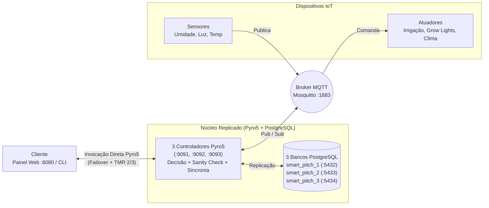

# Relatório Técnico — 1º Trabalho Prático de Sistemas Distribuídos

**Tema:** Gestão Automatizada de Estádios — Subsistema *Smart Pitch* (Manutenção Inteligente de Gramado Esportivo)  
**Tecnologias Utilizadas:** Python 3, Eclipse Mosquitto (MQTT via Docker), PostgreSQL 16 (3 instâncias independentes via Docker), `paho-mqtt`, `Pyro5` e `psycopg`.

---

## 1. Introdução e Escolha do Tema

O presente trabalho implementa uma arquitetura completa de Sistemas Distribuídos combinando **comunicação indireta baseada em Publish/Subscribe (MQTT)** para dispositivos IoT de campo e **comunicação direta baseada em Objetos Distribuídos (Pyro5)** entre Clientes e Controladores de Processo, com persistência replicada em **3 bancos PostgreSQL independentes**.

### 1.1. O Cenário *Smart Pitch*
Arenas esportivas multiuso modernas enfrentam desafios contínuos para manter a integridade agronômica e biomecânica do gramado. O subsistema **Smart Pitch** monitora e controla três malhas físicas acopladas:

1. **Controle Hídrico:**
   - **Sensor:** Umidade do Solo (`%`).
   - **Atuador:** Sistema de Irrigação por *Sprinklers* (`LIGADO` / `DESLIGADO`).
   - **Regra com Histerese:** Aciona a irrigação abaixo de `40%` e desliga apenas ao atingir `65%`, evitando oscilações curtas (*chattering*).
2. **Controle Fotossintético:**
   - **Sensor:** Luminosidade / Radiação PAR (`lux`).
   - **Atuador:** Painéis de Iluminação Artificial *Grow Lights* (`LIGADO` / `DESLIGADO`).
   - **Regra:** Liga sempre que a radiação natural for inferior a `12.000 lux`.
3. **Controle Térmico Radicular:**
   - **Sensor:** Temperatura da Raiz da Grama (`°C`).
   - **Atuador:** Climatização Subterrânea (`AQUECENDO` / `RESFRIANDO` / `DESLIGADO`).
   - **Regra:** Aquece abaixo de `16 °C`, resfria acima de `27 °C` e desliga dentro da faixa ótima (`16 °C` a `27 °C`).

Além disso, os controladores implementam **3 modos contextuais de operação**:
- **`AUTOMATICO`:** Decisões autônomas pelas regras agronômicas.
- **`DIA_DE_JOGO`:** Bloqueia *sprinklers* e *Grow Lights* para não interromper a partida, mantendo apenas a climatização subterrânea.
- **`MANUAL`:** Operador comanda diretamente os atuadores pelo Cliente.

---

## 2. Arquitetura e Funcionamento do Sistema

A arquitetura segue fielmente o modelo do enunciado: os Clientes invocam métodos **diretamente** nos Controladores de Processo via Pyro5 (sem servidor intermediário), enquanto os Controladores sincronizam estado entre si, replicam dados em bancos PostgreSQL individuais e interagem com Sensores e Atuadores via Broker MQTT.



### 2.1. Fluxo de Dados e Comunicação
1. **Publicação de Sensores (`gramado/sensores.py`):** Publica leituras JSON periodicamente no tópico `estadio/gramado/sensores` via Mosquitto.
2. **Processamento e Persistência (`gramado/controlador.py` + `gramado/storage_db.py`):** Cada réplica assina `estadio/gramado/sensores`, aplica *Sanity Check* nos valores recebidos, executa as regras de decisão, publica comandos em `estadio/gramado/atuadores` quando há mudança e persiste em seu respectivo PostgreSQL.
3. **Atuação Física (`gramado/atuadores.py`):** Assina `estadio/gramado/atuadores` e reflete as transições físicas dos equipamentos.
4. **Comunicação Direta Baseada em Objetos (`gramado/cliente_rpc.py`, `gramado/painel_web.py`, `gramado/cliente.py`):** O Cliente utiliza o *stub* local `ClienteControladoresRPC` para invocar métodos remotos diretamente nos objetos `ControladorGramado` (`9091`, `9092` e `9093`) via `Pyro5`.

---

## 3. Soluções para os Problemas de Sistemas Distribuídos

### 3.1. Replicação dos Dados Armazenados
> **Requisito:** *"O controlador escolhido possui sempre uma ou várias réplicas para os dados armazenados."*

**Solução Implementada:**
- Cada controlador possui um banco de dados **PostgreSQL independente** rodando em container próprio (`smart_pitch_1` na porta `5432`, `smart_pitch_2` na `5433` e `smart_pitch_3` na `5434`), gerenciado pela classe `StoragePostgres` (`gramado/storage_db.py`) com as tabelas `estado_gramado` e `historico_eventos`.
- Cada registro mantém um contador monotônico crescente (`versao`) e o histórico dos últimos 10 eventos.
- **Propagação e Recuperação:**
  - Alterações via comando remoto (`definir_modo` e `acionar_atuador_manual`) disparam `_propagar_replicacao()`, invocando `receber_replicacao()` nas demais réplicas via Pyro5.
  - Ao reiniciar após uma queda, `sincronizar_ao_iniciar()` consulta as réplicas íntegras ativas, valida os dados via *Sanity Check* e adota o estado válido de maior versão, gravando-o no PostgreSQL local.

---

### 3.2. Tolerância a Falhas por Queda de Controlador
> **Requisito:** *"Garantir que o cliente obtenha um resultado positivo quanto a execução de um método, mesmo que o controlador caia."*

**Solução Implementada:**
- Sem depender de servidor intermediário único, a camada de invocação direta no Cliente (`ClienteControladoresRPC` em `gramado/cliente_rpc.py`) itera sobre as URIs Pyro5 das réplicas (`9091`, `9092`, `9093`) com *timeout* curto (`1.5s`) e tratamento de exceções de rede.
- Caso um ou até dois controladores caiam (*crash*), o nó inacessível é marcado como `OFFLINE (Inacessivel)` no diagnóstico, mas o método conclui normalmente usando as réplicas sobreviventes e retorna sucesso ao cliente.

---

### 3.3. Segurança: Controladores Invadidos ou com Erros Intermitentes
> **Requisito:** *"Resolver problemas de segurança: se os controladores começarem a responder valores que não conferem, seja por motivo de terem sido invadidos ou por erros intermitentes?"*

**Solução Implementada (Defesa em Duas Camadas):**
1. **1ª Barreira — Validação Física e Semântica (*Sanity Check*):**
   - Implementada de forma compartilhada em `gramado/config.py` (`validar_leituras_sensores` e `validar_estado_plausivel`) e aplicada tanto nos **Controladores** (ao receber leituras MQTT, replicações e sincronização) quanto no **Cliente** (ao receber respostas Pyro5).
   - Bloqueia modos fora de `("AUTOMATICO", "DIA_DE_JOGO", "MANUAL")`, estados inválidos de atuadores e leituras fora dos limites físicos (`Umidade: 0..100%`, `Luminosidade: 0..150.000 lux`, `Temperatura: -10..60 °C`), impedindo inclusive que dados corrompidos sejam gravados no PostgreSQL.
2. **2ª Barreira — Redundância Modular Tripla (TMR) com Votação por Maioria ($2f + 1$):**
   - Mesmo que um controlador invadido ou com erro intermitente retorne valores dentro da faixa física (por exemplo, informando `irrigacao = "LIGADO"` quando deveria ser `"DESLIGADO"`), a camada direta do Cliente compara a assinatura de resposta das 3 réplicas por **votação majoritária (Quórum 2 de 3)**.
   - O voto minoritário divergente é descartado com registro de alerta de segurança no painel, e o operador recebe a decisão validada pela maioria íntegra.

---

## 4. Execução e Validação Prática

1. Subir o Broker MQTT e os 3 bancos PostgreSQL:
   ```bash
   docker compose up -d
   ```
2. Instalar dependências:
   ```bash
   pip install -r requirements.txt
   ```
3. Iniciar o gerenciador unificado (1 terminal + Painel Web em `http://127.0.0.1:8080`):
   ```bash
   python gramado/start_all.py
   ```
4. **Experimentos de Validação:**
   - **Replicação PostgreSQL:** Verificar no painel a versão sincronizada entre os 3 bancos (`smart_pitch_1`, `smart_pitch_2`, `smart_pitch_3`).
   - **Queda de Controlador:** Pressionar `1` no terminal do `start_all.py` para derrubar o Controlador 1; alterar o modo pelo painel web e confirmar execução positiva com quórum `2/3`. Religar com `1` novamente e observar a recuperação automática de versão.
   - **Invasão / Falha Bizantina:** Clicar em **Simular Invasao** no Controlador 2 pelo painel web; o sistema isola o Controlador 2 com alerta de segurança e continua entregando os valores íntegros validados pelos Controladores 1 e 3.
