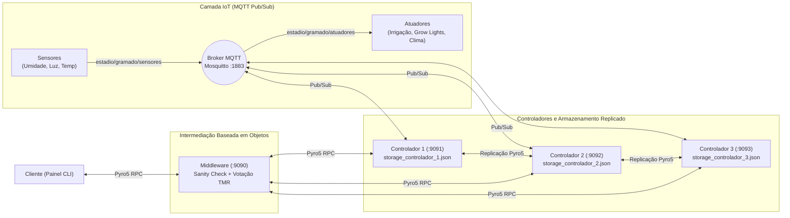

# Relatório Técnico — 1º Trabalho Prático de Sistemas Distribuídos

**Tema:** Gestão Automatizada de Estádios — Subsistema *Smart Pitch* (Manutenção Inteligente de Gramado Esportivo)  
**Tecnologias Utilizadas:** Python 3, Eclipse Mosquitto (MQTT via Docker), `paho-mqtt` e `Pyro5` (Objetos Distribuídos).

---

## 1. Introdução e Escolha do Tema

O presente trabalho implementa uma arquitetura completa de Sistemas Distribuídos combinando **comunicação indireta baseada em Publish/Subscribe (MQTT)** para dispositivos IoT de campo e **comunicação direta baseada em Objetos Distribuídos (Pyro5)** para gerência, replicação, tolerância a falhas e interação com o usuário.

### 1.1. O Cenário *Smart Pitch*
Arenas esportivas multiuso modernas (que recebem partidas oficiais e grandes eventos) enfrentam desafios severos para manter a integridade agronômica e biomecânica do gramado. Coberturas parciais reduzem a incidência solar, enquanto variações térmicas e hídricas afetam diretamente a tração dos atletas e a rolagem da bola.

Para atender à exigência de um tema relevante e não trivial, o subsistema **Smart Pitch** monitora e controla continuamente três malhas físicas acopladas:

1. **Controle Hídrico:**
   - **Sensor:** Umidade do Solo (`%`).
   - **Atuador:** Sistema de Irrigação por *Sprinklers* (`LIGADO` / `DESLIGADO`).
   - **Regra com Histerese:** Aciona a irrigação quando a umidade cai abaixo de `40%` e desliga apenas ao atingir o patamar ideal de `65%`, evitando oscilações curtas (*chattering*) nas bombas hidráulicas.
2. **Controle Fotossintético:**
   - **Sensor:** Luminosidade / Radiação Fotossinteticamente Ativa — PAR (`lux`).
   - **Atuador:** Painéis de Iluminação Artificial *Grow Lights* (`LIGADO` / `DESLIGADO`).
   - **Regra:** Suplementa a iluminação sempre que a radiação natural for inferior a `12.000 lux`.
3. **Controle Térmico Radicular:**
   - **Sensor:** Temperatura da Raiz da Grama (`°C`).
   - **Atuador:** Climatização Subterrânea (`AQUECENDO` / `RESFRIANDO` / `DESLIGADO`).
   - **Regra:** Ativa aquecimento abaixo de `16 °C`, resfriamento/ventilação acima de `27 °C` e desliga dentro da faixa ótima (`16 °C` a `27 °C`).

Além das regras baseadas em sensores, os controladores implementam **modos contextuais de operação**:
- **`AUTOMATICO`:** Os controladores tomam decisões autônomas com base nas três malhas de sensores.
- **`DIA_DE_JOGO`:** Regra crítica de segurança operacional — bloqueia imediatamente os *sprinklers* de irrigação e os carrinhos de *Grow Lights* para não interromper uma partida em andamento, mantendo ativa apenas a climatização subterrânea da raiz.
- **`MANUAL`:** Permite que o operador assuma o comando direto individual de cada atuador através do Cliente.

---

## 2. Arquitetura e Funcionamento do Sistema

A arquitetura implementada segue rigorosamente o modelo proposto na especificação do trabalho, expandindo o núcleo de controle para **3 réplicas ativas** a fim de viabilizar o consenso por maioria contra falhas bizantinas:



### 2.1. Fluxo de Dados e Comunicação
1. **Publicação de Sensores (`gramado/sensores.py`):** Publica periodicamente um pacote JSON no tópico `estadio/gramado/sensores` via Broker MQTT Mosquitto.
2. **Processamento nos Controladores (`gramado/controlador.py`):** As réplicas dos controladores assinam `estadio/gramado/sensores`, atualizam seu estado interno, executam a lógica de decisão conforme o modo vigente e publicam comandos de atuação no tópico `estadio/gramado/atuadores`.
3. **Atuação Física (`gramado/atuadores.py`):** Assina `estadio/gramado/atuadores` e reflete imediatamente no terminal as transições de estado físico dos equipamentos.
4. **Intermediação por Objetos (`gramado/middleware.py` e `gramado/cliente.py`):** O Cliente invoca métodos remotos no objeto `MiddlewareGramado` (`obter_visao_geral`, `definir_modo_operacao`, `acionar_atuador`), que coordena as chamadas às réplicas `ControladorGramado` via `Pyro5`.

---

## 3. Soluções para os Problemas de Sistemas Distribuídos

A seguir são detalhadas as soluções arquiteturais e algorítmicas desenvolvidas para cada questão exigida na especificação.

### 3.1. Replicação dos Dados Armazenados
> **Requisito:** *"O controlador escolhido possui sempre uma ou várias réplicas para os dados armazenados."*

**Solução Implementada:**
- Cada instância do controlador mantém seu próprio armazenamento persistente em arquivo JSON estruturado (`gramado/storage/storage_controlador_1.json`, `storage_controlador_2.json` e `storage_controlador_3.json`).
- O estado armazenado contém um **número de versão monotônico crescente (`versao`)**, o modo de operação, a última leitura dos sensores, o estado dos atuadores e o histórico auditável dos últimos eventos.
- **Sincronização Ativa e Propagação:**
  - Sempre que um controlador processa uma alteração de modo ou comando manual (`definir_modo` ou `acionar_atuador_manual`), ele incrementa a `versao`, grava em seu armazenamento local e invoca remotamente o método `receber_replicacao(estado)` nas demais réplicas.
  - **Recuperação pós-queda (`sincronizar_ao_iniciar`):** Quando um controlador que estava desligado é reiniciado, ele consulta as réplicas ativas antes de entrar em operação; caso encontre uma versão de estado superior à sua (`versao_remota > versao_local`), atualiza imediatamente seu arquivo JSON local.

---

### 3.2. Tolerância a Falhas por Queda de Controlador
> **Requisito:** *"Garantir que o cliente obtenha um resultado positivo quanto à execução de um método, mesmo que o controlador caia."*

**Solução Implementada:**
- **Transparência de Localização e Falha no Middleware:** O Cliente nunca referencia um controlador específico; todas as chamadas são feitas exclusivamente ao objeto `MiddlewareGramado`.
- Ao receber uma invocação do Cliente, o Middleware itera sobre as URIs das réplicas configuradas (`Portas 9091, 9092 e 9093`) aplicando um *timeout* de rede enxuto (`1.5s`) e capturando exceções de comunicação (`Pyro5.errors.CommunicationError`).
- Se o `Controlador 1` sofrer uma falha por parada (*crash*), o Middleware registra seu status como `OFFLINE (Inacessivel)` no diagnóstico, mas **prossegue a execução utilizando os `Controladores 2 e 3`**.
- Dessa forma, mesmo que 1 ou até 2 controladores caiam simultaneamente, o Cliente recebe um retorno positivo e transparente da execução do método sem qualquer interrupção de serviço.

---

### 3.3. Segurança: Controladores Invadidos ou com Erros Intermitentes
> **Requisito:** *"Resolver problemas de segurança: se os controladores começarem a responder valores que não conferem, seja por motivo de terem sido invadidos ou por erros intermitentes?"*

**Solução Implementada (Defesa em Duas Camadas para Falhas Bizantinas):**

Quando um controlador é invadido ou sofre falha intermitente de memória/rede, ele deixa de apresentar uma falha simples de parada e passa a exibir uma **Falha Bizantina** (continua respondendo, porém com dados falsos ou corrompidos). Para resolver esse problema de forma determinística, o Middleware implementa duas barreiras complementares:

1. **1ª Barreira — Validação Física e Semântica (*Sanity Check*):**
   - O método `_validar_estado_plausivel()` inspeciona toda resposta recebida de um controlador antes de considerá-la válida.
   - Verifica se o modo de operação pertence a `("AUTOMATICO", "DIA_DE_JOGO", "MANUAL")`, se os estados dos atuadores pertencem ao conjunto válido e se as grandezas dos sensores estão dentro das faixas físicas reais (`Umidade: 0% a 100%`, `Luminosidade: 0 a 150.000 lux`, `Temperatura: -10 °C a 60 °C`).
   - Caso um invasor injete valores absurdos (ex.: `umidade_solo = 999.9%` ou `modo = "MODO_HACKED"`), a resposta é imediatamente descartada e o controlador é classificado como `INVADIDO/ERRO`.

2. **2ª Barreira — Redundância Modular Tripla (TMR) com Votação por Maioria ($2f + 1$):**
   - Um atacante sofisticado (ou um erro intermitente sutil) poderia retornar valores falsos que ainda respeitam os limites físicos (por exemplo, informar que a irrigação está `LIGADO` quando deveria estar `DESLIGADO`).
   - Pela teoria de consenso distribuído, para mascarar $f = 1$ componente malicioso/defeituoso, são necessárias pelo menos $2f + 1 = 3$ réplicas.
   - O Middleware extrai uma **assinatura de consenso** de cada resposta fisicamente válida e utiliza `collections.Counter` para realizar uma **votação por maioria (Quórum 2 de 3)**.
   - A resposta confirmada pela maioria (2 controladores íntegros) é entregue ao Cliente, enquanto o controlador divergente tem seu voto descartado e gera um alerta imediato no painel de segurança do operador.

---

## 4. Roteiro de Execução e Validação Prática

### 4.1. Inicialização do Ambiente
1. Subir o Broker MQTT Mosquitto via Docker na raiz do projeto:
   ```bash
   docker compose up -d
   ```
2. Instalar as dependências Python:
   ```bash
   pip install -r requirements.txt
   ```
3. Iniciar todos os componentes do subsistema `gramado` com o inicializador automático:
   ```bash
   python gramado/start_all.py
   ```

### 4.2. Experimentos de Validação dos Requisitos
- **Experimento 1 (Operação Normal e Replicação):** No painel do Cliente, observar o quórum `3/3 controladores concordam` e verificar na pasta `gramado/storage/` que os arquivos `storage_controlador_1.json`, `2` e `3` possuem exatamente a mesma versão e conteúdo.
- **Experimento 2 (Queda de Controlador):** Fechar a janela do `Controlador 1` (ou pressionar `Ctrl+C`) e, no Cliente, alterar o modo de operação na opção `[3]`. O método retornará sucesso normalmente com quórum `2/3`, listando o Controlador 1 como `OFFLINE (Inacessivel)`.
- **Experimento 3 (Invasão / Falha Bizantina):** No menu do Cliente, selecionar a opção `[5]` e ativar a simulação de invasão no `Controlador 2`. Em seguida, atualizar o painel (`[1]`): o Middleware identificará a adulteração, isolará o `Controlador 2` com um alerta de segurança e continuará exibindo ao Cliente os valores corretos validados pelos `Controladores 1 e 3`.

